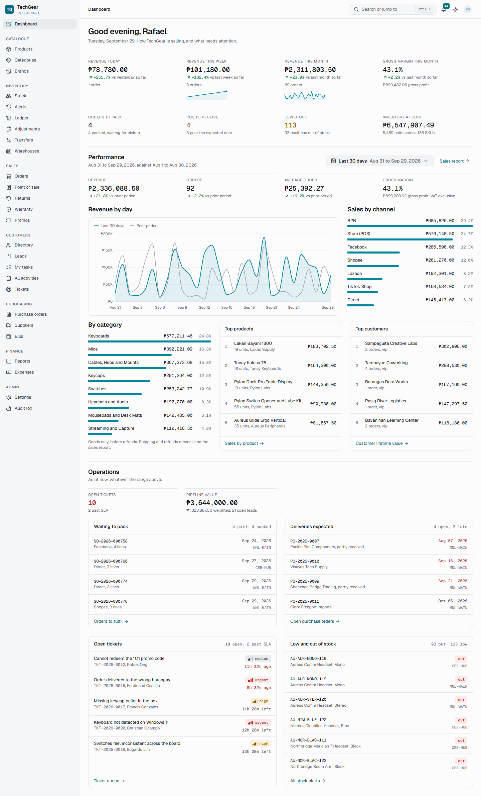
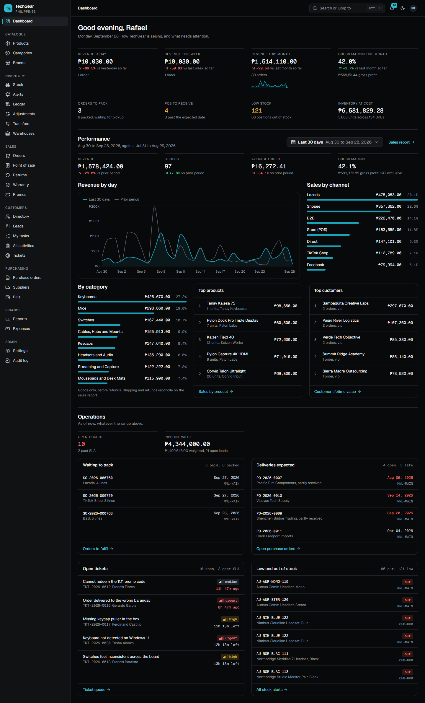
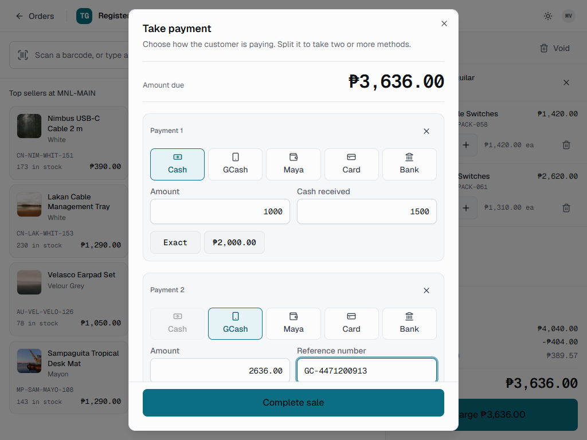
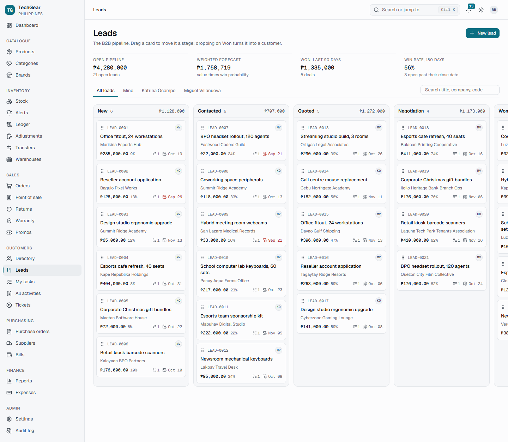
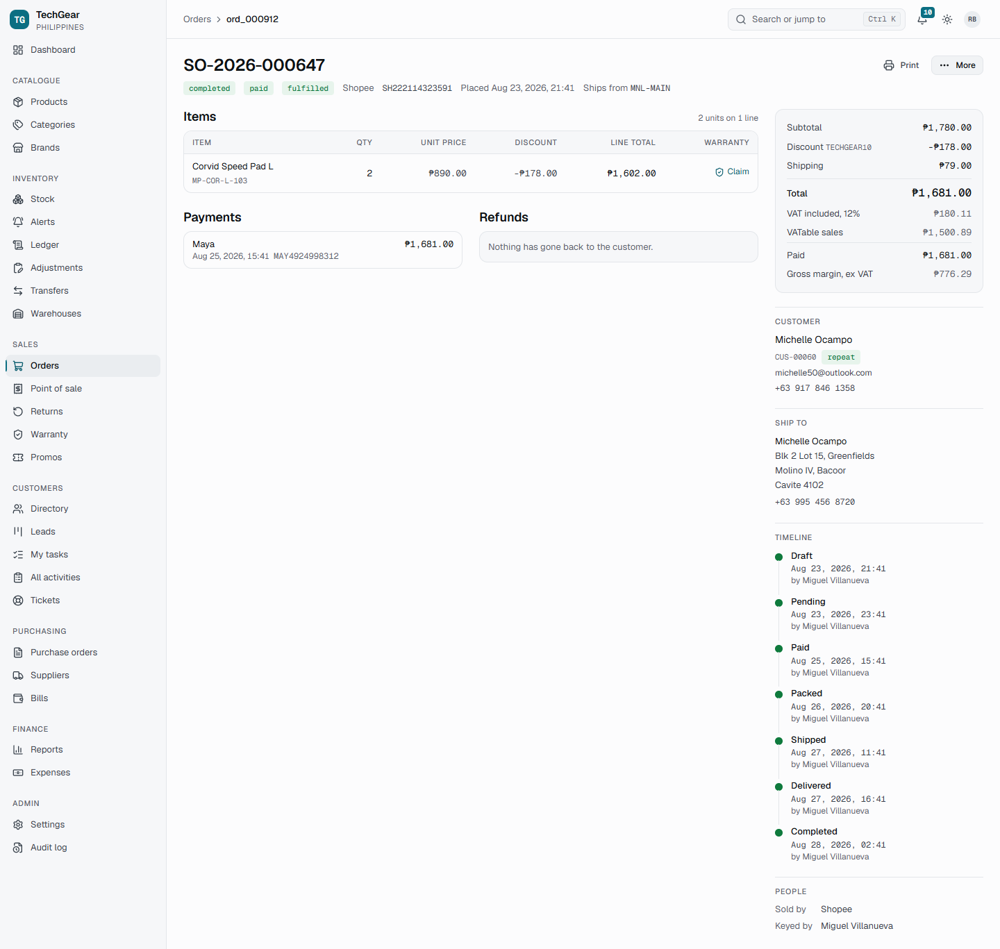
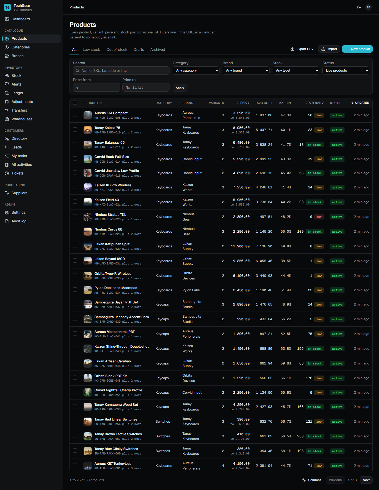
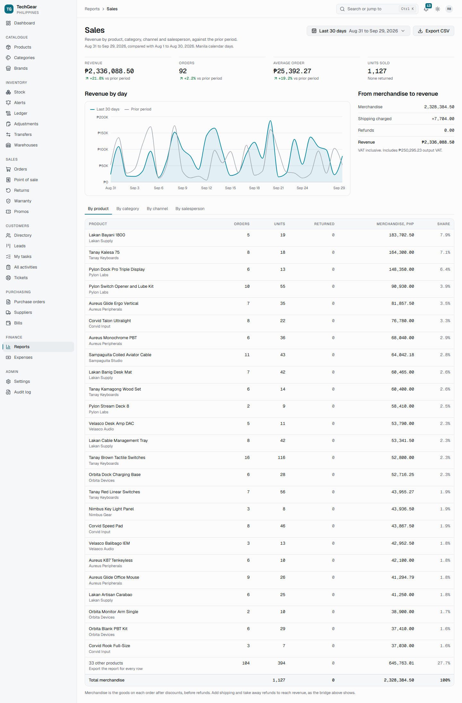
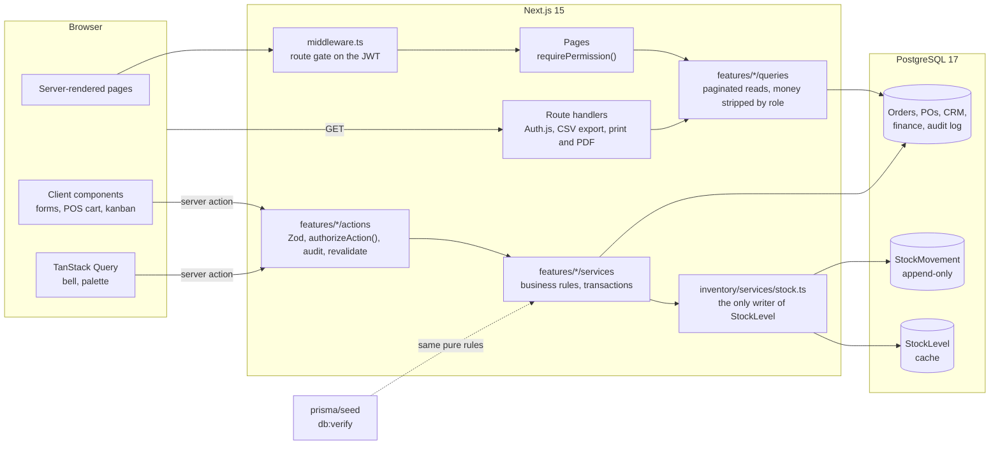
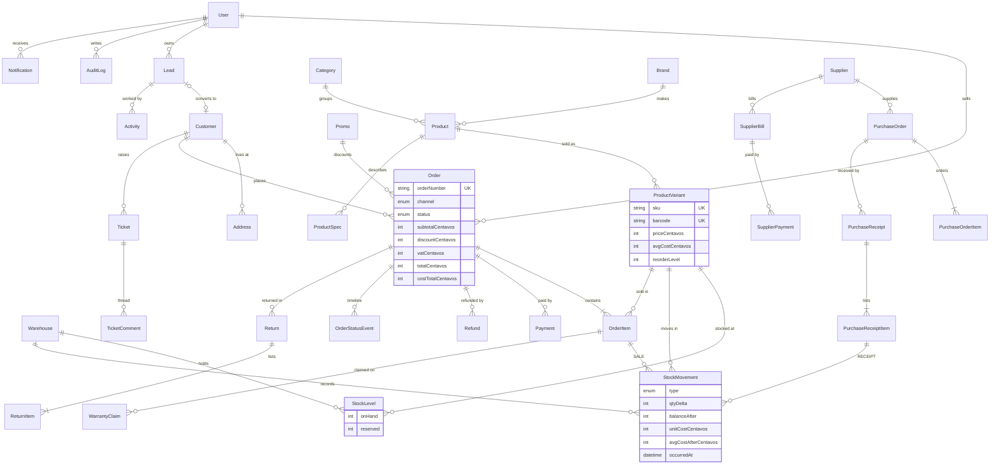

# TechGear ERP

A CRM and ERP for **TechGear PH**, a fictional Philippine retailer of mechanical
keyboards, keycaps, switches, mice, headsets and streaming gear. One app runs
the catalogue and a stock ledger across two warehouses, orders from seven sales
channels, a tablet point of sale, purchasing and payables, a CRM with a lead
kanban and support tickets, and finance reporting with a profit and loss.

It is a portfolio project, built to behave like a product rather than a demo:
money is exact to the centavo, stock cannot be oversold under concurrent load,
every permission is checked on the server, and a year of realistic seeded
history means every chart has something to say the moment it starts.



<table>
  <tr>
    <td></td>
    <td></td>
  </tr>
  <tr>
    <td></td>
    <td></td>
  </tr>
  <tr>
    <td></td>
    <td></td>
  </tr>
</table>

Every page is captured at 1440, 1024 and 390 pixels in light and dark in
[docs/screenshots/](docs/screenshots), named `<page>-<theme>-<width>.png`.

## Contents

- [Features](#features)
- [Stack](#stack)
- [Getting started](#getting-started)
- [Demo accounts](#demo-accounts)
- [Architecture](#architecture)
- [Data model](#data-model)
- [Key design decisions](#key-design-decisions)
- [Testing](#testing)
- [Scripts](#scripts)
- [Folder structure](#folder-structure)
- [What I learned](#what-i-learned)
- [Next steps](#next-steps)
- [Credits](#credits)

## Features

**Catalogue and inventory**

- Products with brands, categories, specs, tags, images and variants (colour,
  switch, layout), each variant with its own SKU, barcode, price, cost and
  reorder level.
- A stock ledger: every receipt, sale, return, adjustment and transfer is an
  append-only movement with its running balance and moving-average cost.
- Low and out-of-stock alerts per warehouse, reorder suggestions per company,
  adjustments with reasons, and transfers that are counted in neither warehouse
  while on the truck.
- Server-side pagination, sorting, filtering and search, column visibility,
  barcode and SKU lookup, CSV import with a reviewed diff, CSV export, bulk
  price updates.

**Sales, POS and after-sales**

- Orders across POS, Shopee, Lazada, TikTok Shop, Facebook, Direct and B2B,
  with an enforced lifecycle from Draft to Completed, plus Cancelled and
  Refunded.
- GCash, Maya, bank transfer, card, cash and COD, including split payments.
  Promo codes, manual discounts capped by role, VAT and shipping.
- A tablet-first POS register: barcode scanning, a touch-sized cart, an
  optional customer, cash tendered and change, and a printable receipt.
- Printable invoices and receipts, and real PDFs drawn on the server.
- Returns that restock or write off each line and refund exactly what was paid,
  and warranty claims resolved by a replacement or a refund.

**CRM**

- Individual and business customers with Philippine addresses (province, city,
  barangay), a Customer 360 view, and automatic VIP, Repeat, New and Dormant
  segments.
- A drag-and-drop lead kanban that refuses skipped stages and converts won
  leads into customers.
- Activities with due dates and a "My tasks" view, and support tickets with SLA
  targets counted in Manila business hours.

**Purchasing and finance**

- Suppliers with measured on-time and defect rates, purchase orders received in
  parts with dock rejects, supplier bills, payments and payables aging.
- A role-aware dashboard and ten reports (sales, gross profit, profit and loss,
  VAT, aging, purchases, inventory valuation, stock movement, slow-moving stock,
  customer lifetime value), each with a date range, a comparison period and CSV
  export. Expenses feed the P&L and the VAT summary.

**Across the app**

- Four roles (Admin, Manager, Sales, Warehouse) enforced on the server, an audit
  log with field-level diffs, login rate limiting.
- A Ctrl/Cmd+K command palette, a notification centre, `j`/`k` row navigation,
  light and dark themes, loading skeletons shaped like each page, error
  boundaries, and 403 and 404 pages inside the shell.
- Accessibility enforced by an axe sweep over every page in both themes, and
  every colour pair checked against WCAG.

## Stack

| Area      | Choice                                                                  |
| --------- | ----------------------------------------------------------------------- |
| Framework | Next.js 15 (App Router), React 19, TypeScript strict                    |
| UI        | Tailwind CSS v4, shadcn/ui, lucide-react, Recharts, dnd-kit             |
| Data      | PostgreSQL 17 (Docker Compose), Prisma 7                                |
| Auth      | Auth.js v5 (credentials, JWT sessions), bcrypt                          |
| Forms     | Zod (shared by form and server), React Hook Form                        |
| Client    | TanStack Table, TanStack Query (the notification bell and palette only) |
| Mutations | Server Actions, everywhere                                              |
| Quality   | Vitest, Playwright, ESLint, Prettier, GitHub Actions                    |
| Locale    | en-PH, PHP, Asia/Manila, 12% VAT                                        |

## Getting started

You need **Node.js 20.19, 22.12 or 24+** (Prisma 7's floor; developed on 24) and
**Docker**.

```bash
git clone https://github.com/<you>/techgear-erp.git
cd techgear-erp
cp .env.example .env.local   # works as-is for local use
docker compose up -d         # Postgres 17 on :5432
npm i
npx prisma migrate dev       # create the schema
npm run db:seed              # 12 months of demo data, about 15 seconds
npm run dev                  # http://localhost:3000
```

Sign in with any of the [demo accounts](#demo-accounts).

Notes:

- `.env.example` carries a placeholder `AUTH_SECRET` that is long enough to
  boot. Replace it (`npx auth secret`) before deploying anywhere.
- Every environment variable is validated on boot by `src/lib/env.ts`. The app
  refuses to start with a clear message rather than failing at the first query.
- If port 3000 is taken, run `npx next dev -p 3100` and set `AUTH_URL` in
  `.env.local` to the same origin. Auth.js rebuilds request URLs from it.
- The seed is deterministic in shape (a fixed faker seed) but dated relative to
  today, so the dashboard is never empty. `npm run db:reset` drops, migrates and
  reseeds; `npm run db:verify` runs 122 integrity checks over the result.

## Demo accounts

All four use the password **`techgear123`**.

| Email                   | Role      | Sees                                                          |
| ----------------------- | --------- | ------------------------------------------------------------- |
| `admin@techgear.ph`     | Admin     | Everything, including users, settings and the audit log       |
| `manager@techgear.ph`   | Manager   | Everything except deletes, user management and settings       |
| `sales@techgear.ph`     | Sales     | Orders, POS, customers, leads and tickets                     |
| `warehouse@techgear.ph` | Warehouse | Stock, receiving, transfers and fulfilment (no money columns) |

A fifth user, `jerome.flores@techgear.ph`, is deactivated on purpose so user
management has a realistic mix. The full matrix is in
[docs/permissions.md](docs/permissions.md).

**What the seed contains:** 68 products and 153 variants across 12 brands and 8
categories, 2 warehouses, about 1,050 orders over 12 months on all seven
channels with 11.11 and 12.12 spikes, about 3,300 ledger movements, 8 suppliers
and 15 purchase orders in every status, 120 customers with real PH addresses,
30 leads, 20 tickets, returns, warranty claims and 13 months of expenses.

## Architecture



- **Reads** are React Server Components calling `queries/`, server-paginated
  with explicit `select`. Money columns are removed in the query for roles that
  may not see them, not hidden in the page.
- **Writes** are Server Actions only. Each one validates with the same Zod
  schema the form used, calls `authorizeAction`, runs a service inside a
  transaction, writes the audit entry and notifications in that transaction,
  and revalidates.
- **Services** hold the business rules and never touch `next/headers` or the
  session, so Vitest and the seed call them directly. Pure rules (pricing,
  transitions, receiving plans) are split out so client components can preview
  with exactly what the server will enforce.
- **Stock** is written only by `applyMovement`, `reserveStock` and
  `releaseStock`, which lock the document first and the variants second.

## Data model

43 Prisma models. The core of them, and how they connect:



The full schema, with every index and the reasoning behind each table, is
[prisma/schema.prisma](prisma/schema.prisma) and section 1 of
[docs/PLAN.md](docs/PLAN.md). `CHECK` constraints (no negative on-hand,
reserved never above on-hand) live in `prisma/migrations/*_constraints`.

## Key design decisions

Every judgement call is numbered and recorded in
[docs/PLAN.md](docs/PLAN.md) section 8. The ones that shape everything else:

**Money is integer centavos.** No floats and no `Decimal` anywhere. Prices,
totals, costs and VAT are `Int` centavos; rates are basis points. One module,
`src/lib/money.ts`, owns every conversion and rounding decision: it rounds half
away from zero so a refund mirrors its sale, spreads order-level VAT and
discounts over lines by the largest-remainder method so lines always sum to the
header, and throws on overflow instead of wrapping. Typed amounts are parsed as
separate peso and centavo integers, so `1.005` is refused rather than silently
losing a centavo. Prices are VAT-inclusive (the Philippine retail norm) and VAT
is extracted at 12/112; supplier prices are VAT-exclusive, as PH price lists
are.

**Stock is a ledger.** `StockMovement` is append-only truth; `StockLevel` is a
cache maintained in the same transaction. Overselling is blocked three ways: a
conditional `UPDATE` whose `WHERE` clause is the stock check, database `CHECK`
constraints, and one lock order everywhere (document, then promo, then every
variant in byte order), so flows queue instead of deadlocking. A placed order
reserves, payment deducts and snapshots the moving-average cost onto the line,
and later receipts never rewrite historical margin. The tests fire ten buyers at
five units and check that exactly five sell.

**RBAC is enforced on the server, three times.** One typed matrix
(`src/lib/rbac/matrix.ts`) is the only place a permission is granted. Middleware
gates routes on the JWT as a cheap first filter; every page calls
`requirePermission` and every server action calls `authorizeAction`, both of
which re-read the user's role and active flag from the database, so a demoted
or deactivated user is stopped at their next click. Where the matrix says `own`,
the check returns a scope the caller must apply. Hiding a button is a
convenience, never the control.

**Every status change goes through a map.** Orders, returns, warranty claims,
purchase orders, bills, transfers, leads and tickets each declare their allowed
moves; every write locks the row and calls `assertTransition`. The diagrams in
[docs/status-flows.md](docs/status-flows.md) are generated from those maps,
and a test fails if the two disagree.

**Revenue has one definition.** Every sales figure on the dashboard and in the
reports selects from one SQL base, so the dashboard, the sales report, the gross
profit report, the P&L and the VAT summary cannot disagree. `db:verify`
reconciles them against independent SQL.

Decisions made in this last phase:

- **E2E specs read the database.** A flow passes when the rows changed (stock
  went down by exactly what was sold, the ledger has the SALE movement, the PO
  reads Received), not when a page rendered. They run against seeded demo data
  one at a time, and each finds its records by state rather than by id, because
  the seed is dated relative to the day it runs.
- **CI runs the Postgres suite too.** SPEC asks for lint, typecheck and unit
  tests; the ledger's concurrency tests run beside them against a Postgres
  service container, since they are the tests most worth having. E2E runs in a
  separate, non-blocking workflow (D-17) and uploads its report.
- **The setup steps were tested from a clean clone** against a fresh
  database, and two things were fixed: `.env.example` had been caught by the
  `.env*` ignore rule and never committed, and Prisma 7 no longer generates its
  client on install or on `migrate dev`, so `postinstall` now runs
  `prisma generate` (and the config lets it run before `.env.local` exists).
- **The seed always leaves returns in flight.** Returns were rare enough that
  some days' seed had no open return at all. Recent deliveries now come back
  more often, so the returns queue is never empty.

## Testing

| Suite             | Command              | What it covers                                                                                                                                                                                                                                             |
| ----------------- | -------------------- | ---------------------------------------------------------------------------------------------------------------------------------------------------------------------------------------------------------------------------------------------------------- |
| Unit (Vitest)     | `npm run test:unit`  | Money and VAT arithmetic, order totals and discount order, promo eligibility, split-payment settlement, refunds, moving-average cost, stock movement rules, every status machine, the permission matrix and route gate, SLA hours, segments, report ranges |
| Database (Vitest) | `npm run test:db`    | Services against real Postgres in its own database: races for the last units, double receiving, crossing transfers, promo usage limits, lead conversion under contention, ledger invariants after every flow                                               |
| E2E (Playwright)  | `npm run test:e2e`   | Sign in as each role and see only what the matrix grants; create a product; a POS sale reduces stock; a PO receipt increases stock; a lead changes stage on the kanban                                                                                     |
| Seed integrity    | `npm run db:verify`  | 122 checks: SPEC targets, ledger replay, cost averages, money reconciliation, report agreement                                                                                                                                                             |
| Screens           | `npm run shoot`      | Every page at three widths in both themes; fails on any console error                                                                                                                                                                                      |
| Accessibility     | `npm run check:a11y` | axe, WCAG 2.1 A and AA, every page in light and dark                                                                                                                                                                                                       |

`npm test` runs the unit and database projects. The database project creates
and migrates `techgear_erp_test`, so the demo data is never touched; set
`SKIP_DB_TESTS=1` to run only unit tests without Docker.

The e2e specs change demo data, so reseed afterwards for the pristine set:

```bash
npm run test:e2e             # reuses a running dev server on :3000, or starts one
npm run db:seed
```

Set `E2E_BASE_URL` to point them at a server on another port.

**CI** ([.github/workflows](.github/workflows)): `ci.yml` runs lint,
typecheck, the Prettier check and unit tests, plus the database suite against a
Postgres service. `e2e.yml` migrates and seeds a fresh database, builds, and
runs Playwright against the production server.

## Scripts

| Command                                                        | What it does                                                         |
| -------------------------------------------------------------- | -------------------------------------------------------------------- |
| `npm run dev`                                                  | Dev server on :3000                                                  |
| `npm run build` / `start`                                      | Production build (fails on type or lint errors) and server           |
| `npm run lint` / `typecheck` / `format`                        | ESLint, `tsc --noEmit`, Prettier                                     |
| `npm test`                                                     | Unit tests, then the database suite                                  |
| `npm run test:unit` / `test:db`                                | Either half on its own                                               |
| `npm run test:e2e`                                             | Playwright flows                                                     |
| `npm run db:up` / `db:down` / `db:logs`                        | Postgres via Docker Compose                                          |
| `npm run db:seed`                                              | Deterministic 12 months of demo data                                 |
| `npm run db:reset`                                             | Drop, re-migrate and re-seed                                         |
| `npm run db:verify`                                            | 122 integrity checks over the seeded data                            |
| `npm run db:segments`                                          | Recompute customer segments (the nightly job)                        |
| `npm run db:images`                                            | Redraw the product illustrations into `public/products`              |
| `npm run shoot`                                                | Screenshot sweep into `docs/screenshots`                             |
| `npm run check:a11y`                                           | axe over every page, both themes                                     |
| `npm run check:contrast`                                       | Every theme colour pair against WCAG                                 |
| `npm run verify:<rbac\|crm\|orders\|pos\|purchasing\|finance>` | Longer browser walkthroughs that check the database after each click |
| `npm run gen:permissions`                                      | Regenerate `docs/permissions.md` from the matrix                     |
| `npm run gen:status-flows`                                     | Regenerate `docs/status-flows.md` from the transition maps           |

## Folder structure

```
src/
  app/
    (app)/            authenticated shell: sidebar, top bar, breadcrumbs
    (auth)/           login and the 403 page
    pos/              the register, its own tablet-first layout
    print/            printable invoices and receipts, and their PDFs
    api/              Auth.js and CSV export
  features/<module>/  23 modules, each with the same five folders:
    schemas/            Zod, shared by the form and the server action
    services/           business rules; no session, unit testable
    actions/            "use server": validate, authorize, call, audit
    queries/            server-paginated reads for server components
    components/         feature UI
  components/         ui (shadcn, customised), layout, data-table, charts, feedback
  lib/                db, auth, env, money, vat, rbac, transitions, format
prisma/               schema, migrations, deterministic seed
tests/                Vitest: unit at the top level, integration/ against Postgres
e2e/                  Playwright specs
scripts/              screenshot, a11y and contrast sweeps, verifiers, doc generators
docs/                 plan, design direction, permissions, status flows, screenshots
.github/workflows/    CI and E2E
```

## Documentation

| File                                                 | What it is                                                             |
| ---------------------------------------------------- | ---------------------------------------------------------------------- |
| [docs/PLAN.md](docs/PLAN.md)                         | Plan of record: schema, routes, ledger design, every numbered decision |
| [docs/permissions.md](docs/permissions.md)           | The permission matrix and route gate per role (generated)              |
| [docs/status-flows.md](docs/status-flows.md)         | State diagrams for all eight lifecycles (generated)                    |
| [docs/design-direction.md](docs/design-direction.md) | The UI brief: tokens, borrowed patterns, anti-slop checklist           |
| [DESIGN.md](DESIGN.md)                               | The primary design reference the tokens are derived from               |

## What I learned

- **Where the lock goes matters more than whether there is one.** The plan
  locked each warehouse position. Working through the moving average showed
  that two receipts into different warehouses would each read the old average
  and one would lose the other's update. Locking the variant row, always in the
  same order, guards both. Mocks cannot show this kind of bug, so the ledger
  tests fire real concurrent transactions at Postgres.
- **Time zones break quietly.** The database session runs in Manila, so a
  JavaScript `Date` bound into raw SQL against a `timestamp` column shifts by
  eight hours without any error. Timestamps now come from the database clock,
  taken under the lock, and comparisons use explicit UTC strings.
- **Rounding is a design decision, not an implementation detail.** Per-line VAT
  rounded one line at a time does not add up to the order's VAT. Deciding that
  the header wins and allocating the remainder made invoices, reports and the
  VAT summary agree to the centavo.
- **Seeding through the real rules pays for itself.** A year of history built
  with the same pricing, receiving and segment functions the app uses obeys the
  same invariants as live data, so `db:verify` can check the seed and the
  report queries together, and it became the broadest test in the project.
- **Generated documentation stays true.** The permission matrix and the state
  diagrams are generated from the code that enforces them, with tests that fail
  on drift, so the docs cannot describe a system that no longer exists.
- **Framework upgrades move the ground.** Prisma 7 moved the datasource URL out
  of the schema and stopped loading `.env` files; Auth.js v5's `forbidden()`
  does nothing without an experimental flag. Reading changelogs early saved more
  time than debugging late.

## Next steps

- Landed cost: allocate freight into unit cost on receipt (D-40).
- Philippine public holidays in the SLA business-hours clock.
- BIR-compliant official receipt numbering and series per terminal.
- Marketplace integrations that pull Shopee and Lazada orders instead of keying
  them in.
- Offline tolerance for the POS register, and camera barcode scanning on
  tablets without a scanner.
- Next.js 16 once the stack is unpinned, which also clears the one `npm audit`
  advisory (a build-time postcss dependency inside Next 15).

## Credits

- Visual direction: [Leonxlnx/taste-skill](https://github.com/Leonxlnx/taste-skill)
- Reference design systems: [VoltAgent/awesome-design-md](https://github.com/VoltAgent/awesome-design-md)
  (Linear as the primary reference; Shopify, Stripe and Vercel for patterns)

Design language only. No brand logos, names or assets are reproduced. TechGear
PH and every person, customer and supplier in the seed data are fictional.
