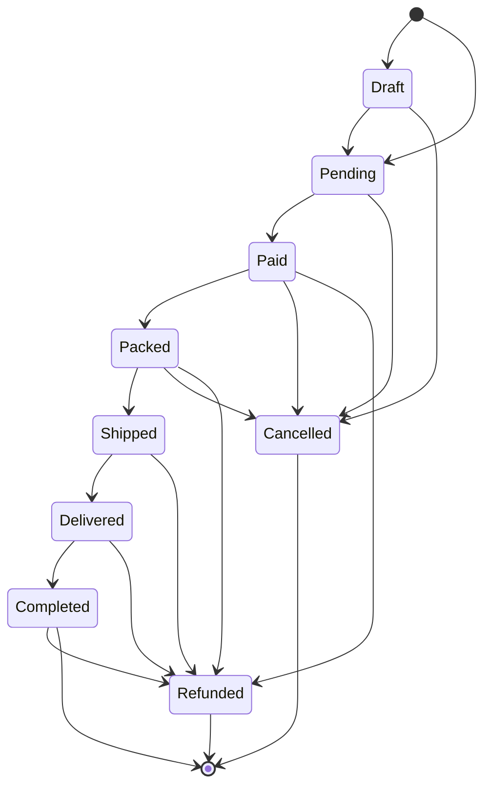
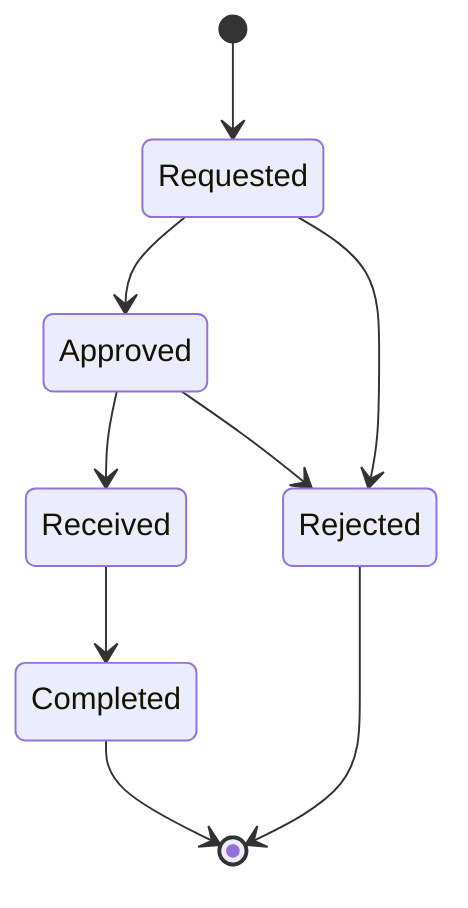
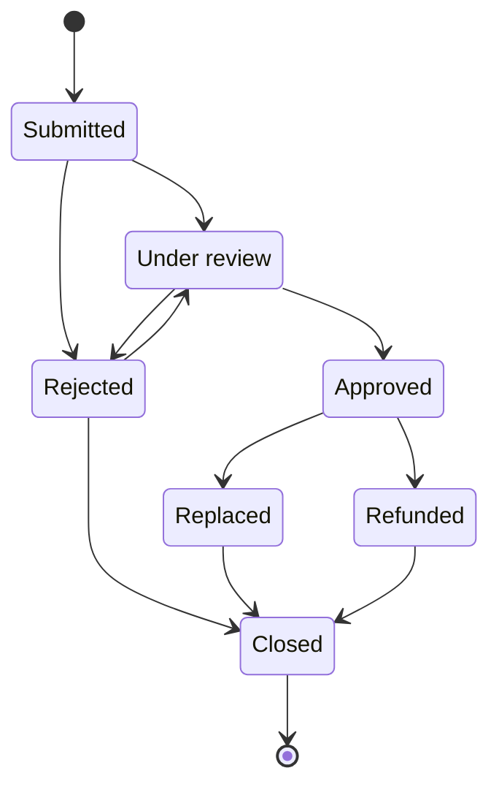
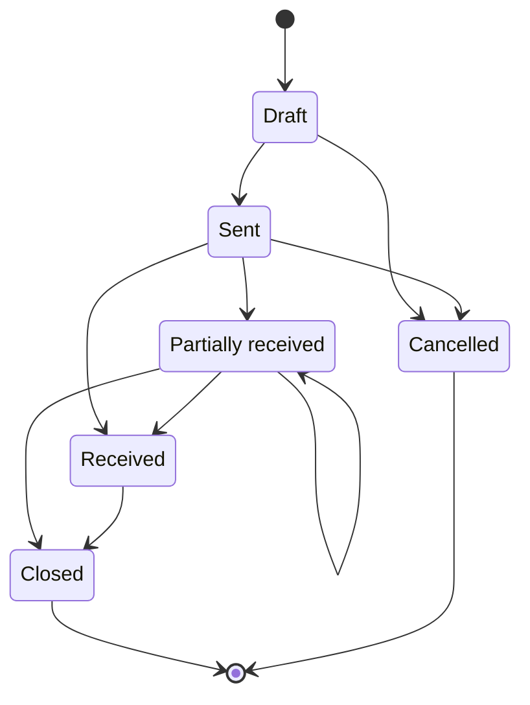
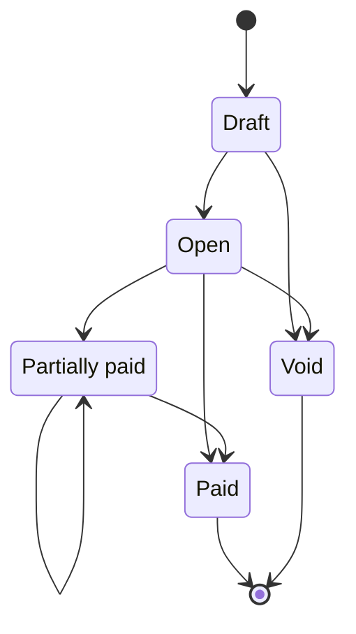
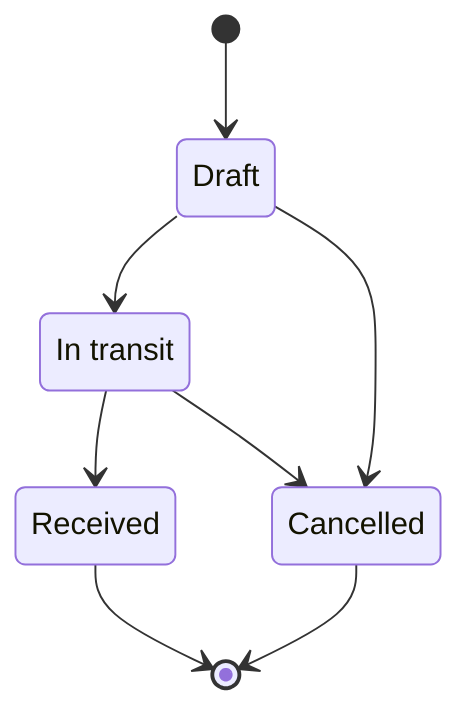
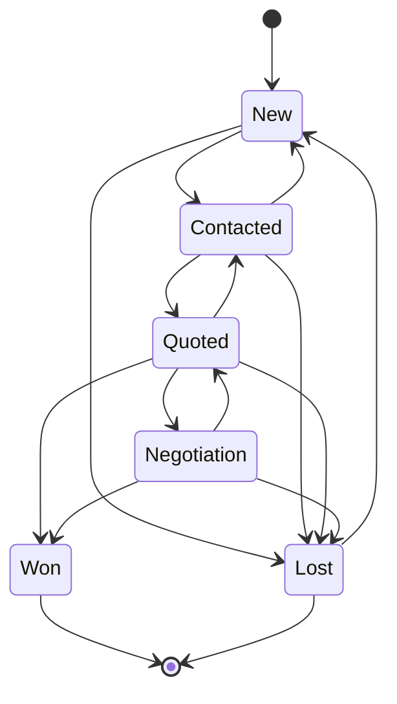
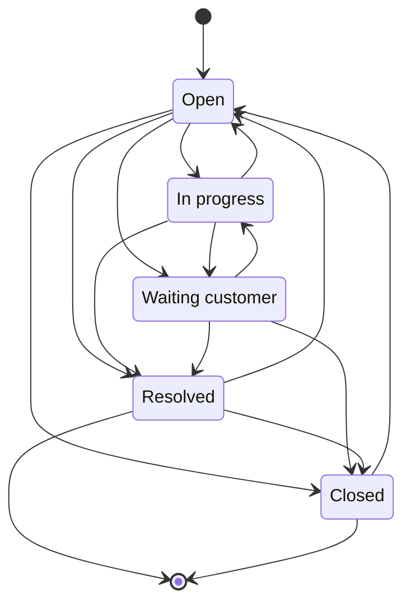

# Status flows

> Generated by `npm run gen:status-flows` from the transition maps the services
> enforce. Do not edit by hand; `tests/status-flows.test.ts` fails when this
> file and the code disagree.

Every entity with a lifecycle declares its allowed moves as a typed map, and
every status write goes through `assertTransition` (`src/lib/transitions.ts`)
after locking the record's row. There is no direct status assignment anywhere,
so an illegal move is a thrown `InvalidTransitionError`, never a quietly
corrupted record. `[*]` marks where a record starts and where its lifecycle
ends. Decision numbers (D-xx) refer to docs/PLAN.md section 8.

| Entity         | Map                    | Source                                                                                                      |
| -------------- | ---------------------- | ----------------------------------------------------------------------------------------------------------- |
| Sales order    | `ORDER_TRANSITIONS`    | [src/features/orders/services/order-rules.ts](../src/features/orders/services/order-rules.ts)               |
| Return (RMA)   | `RETURN_TRANSITIONS`   | [src/features/returns/services/return-rules.ts](../src/features/returns/services/return-rules.ts)           |
| Warranty claim | `WARRANTY_TRANSITIONS` | [src/features/warranty/services/warranty-rules.ts](../src/features/warranty/services/warranty-rules.ts)     |
| Purchase order | `PO_TRANSITIONS`       | [src/features/purchasing/services/purchase-rules.ts](../src/features/purchasing/services/purchase-rules.ts) |
| Supplier bill  | `BILL_TRANSITIONS`     | [src/features/purchasing/services/bill-rules.ts](../src/features/purchasing/services/bill-rules.ts)         |
| Stock transfer | `TRANSFER_TRANSITIONS` | [src/features/inventory/services/transfers.ts](../src/features/inventory/services/transfers.ts)             |
| Lead           | `LEAD_TRANSITIONS`     | [src/features/leads/services/pipeline.ts](../src/features/leads/services/pipeline.ts)                       |
| Support ticket | `TICKET_TRANSITIONS`   | [src/features/tickets/services/tickets.ts](../src/features/tickets/services/tickets.ts)                     |

## Sales order

- Marketplace orders (Shopee, Lazada, TikTok Shop) start at Pending, because the marketplace has already taken them. Every other channel may start as a Draft.
- Pending reserves stock (`reserved += qty`). Paid turns the reservation into SALE movements and snapshots each line's cost from the moving average.
- Cancelling a Draft or Pending order releases the reservation. Cancelling a Paid or Packed order restocks each line with a RETURN movement at the cost it left at and refunds what was paid.
- Completed refreshes the customer's lifetime value, order count and segment.
- Refunded is reached through returns and refunds, and only once all the money or every unit has gone back (D-33). A partial refund leaves the status where it was.
- A POS sale walks the same ladder, Draft to Completed, in one transaction (D-38). There is no POS-only edge.

## Return (RMA)

- Received to Completed is the only step with stock or money effects. Each line is either restocked (a RETURN movement at the original line cost) or written off (a WRITE_OFF row that books the loss and leaves on-hand alone).
- A return never covers more units than are still out on the order line.

## Warranty claim

- A claim is raised against a delivered order line whose warranty has not expired.
- Replaced issues a zero-value replacement order with a real SALE movement at average cost, so the warranty cost lands in the P&L (D-20).
- Refunded pays one unit's share back and writes the faulty unit off.
- Rejected to Under review is the appeal path.

## Purchase order

- The status after a delivery is computed by `statusAfterReceipt`, never chosen: everything in gives Received, anything short gives Partially received (which can repeat).
- Receiving is the only code that writes RECEIPT movements or moves the moving-average cost.
- Cancel is refused once any delivery has been booked. Closing a partly received PO needs a reason.
- Rejected units stay outstanding on the PO, so a replacement delivery can bring them in (D-41).

## Supplier bill

- Payments lock the bill and can never exceed its balance. Partially paid repeats until the balance reaches zero.
- A bill with any payment cannot be voided.

## Stock transfer

- Dispatch writes TRANSFER_OUT at the source. Receiving writes TRANSFER_IN at the destination. In between, the units are on the truck and in neither warehouse's on-hand.
- Cancelling in transit brings the units back to the source with a TRANSFER_IN there.
- Every change locks the transfer row first, so two people pressing Receive add the stock once.

## Lead

- One stage forward or one back, so a mis-drag on the kanban is recoverable. A skip is refused with the missing step named.
- Won is reachable only by converting the lead into a customer, so every won deal has an account for its orders (D-28).
- Lost can be reopened to New.

## Support ticket

- The SLA target is set from priority in business hours, Monday to Saturday, 9 to 6, Manila (D-25). Reopening sets a fresh target.
- First response is stamped by the first reply the customer can see, never by an internal note or a status change.
- A closed ticket can be reopened within 7 days.
